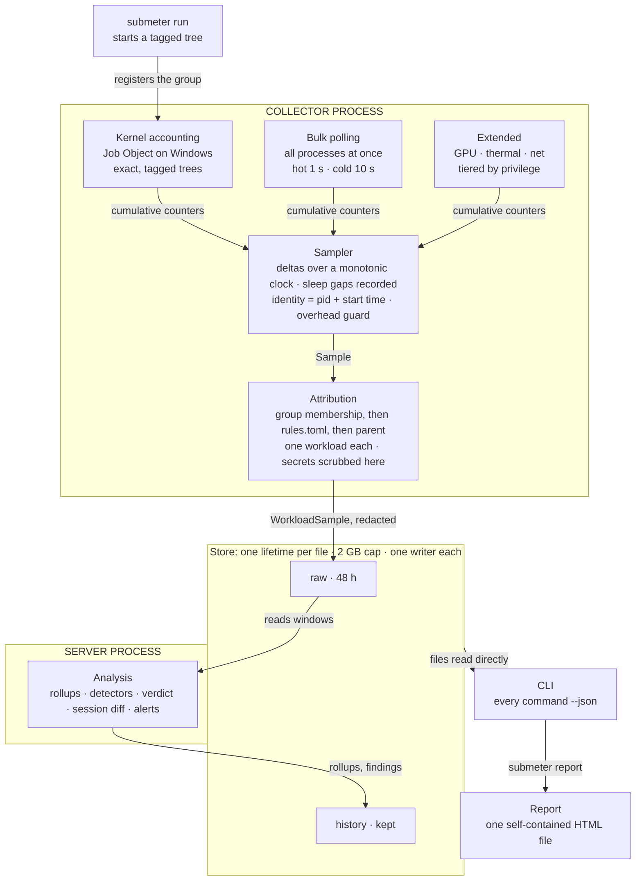

# Data flow

> Submeter build brief · Part 2, the design · [Index](README.md)

Three programs share nothing but files on disk, and each writes only its own. Tagged workloads are measured by the kernel, and polling fills in the rest.

The same flow in words:

1. `submeter run` starts a tagged tree and registers the group with the collector.
2. Inside the collector process, three kinds of provider return cumulative counters. Kernel accounting, through a Job Object on Windows, is exact and covers tagged trees. On Linux tagged runs are unavailable in version 1, so `submeter run` runs the command polled; the cgroup path comes after version 1. It is the provider highlighted in the drawing. Bulk polling reads all processes at once, the hot set every 1 s and the cold set every 10 s. Extended providers cover GPU, thermal and network, tiered by privilege.
3. The sampler turns counters into deltas over a monotonic clock, records sleep gaps, identifies a process by pid plus start time, and runs the overhead guard. It emits a Sample.
4. Attribution gives each process one workload: by group membership, then `rules.toml`, then its parent. Secrets are scrubbed here. It emits a WorkloadSample, redacted.
5. The store has one lifetime per file, a 2 GB cap and one writer for each file: raw files kept 48 h and a history file that is kept.
6. In the server process, analysis reads windows from the store and writes rollups and findings back: rollups, detectors, verdict, session diff and alerts. Hourly buckets are built from raw data.
7. The CLI reads the store files directly, and every command takes `--json`. `submeter report` writes the charts for a session or range into one self-contained HTML file. `submeter session start` and `stop` write a session marker file with an atomic rename, which the server reads. Agents read their own run's cost through the CLI, with `submeter cost --run "$SUBMETER_RUN" --json`, whose output never holds a command line. Version 1 opens no network port: the API and the live dashboard come in version 1.1, and there is no MCP server.

*Figure:* Data moves one way. The highlighted provider is the exact path: the kernel totals CPU, memory and I/O for every process in a tagged group, including ones that exit between samples. Each program writes only its own files: the collector the raw files, the server the history file, and the launcher one small file per run, so a run is accounted for even if the collector was down. `submeter session` writes one marker file per session. Hourly buckets are built from raw data: the server reads windows from the raw files and writes the buckets to the history file.

## Why tagged workloads use kernel accounting

| Method | Share of short-lived CPU time captured |
| --- | --- |
| Polling every 5 s | 6% |
| Polling every 1 s | 29% |
| Polling every 250 ms | 68% |
| Kernel accounting | 100% |

The model: children have exponentially distributed lifetimes with a mean of L, are busy for their whole life, and are polled every T with a random phase. Each is credited up to its last sighting. The captured share is (L ÷ T) × (1 − e^(−T ÷ L)), with L set to 300 ms.

*Figure:* Share of a spawn-heavy workload's CPU time that each method captures. The polling figures are computed, not measured: they assume child processes that live 300 ms on average and credit each one up to its last sighting. On Linux part of the gap can be recovered from the parent's child-time counters. On Windows it cannot.

## What one sample becomes

| Stage | Record | Key fields | Volume per day |
| --- | --- | --- | --- |
| Provider | `Counters` | pid, start time, cumulative CPU seconds, bytes, memory gauges | In memory only |
| Sampler | `Sample` | identity, interval covered, deltas, gap flag | In memory only |
| Attribution | `WorkloadSample` | workload, accounting source, redacted command | 0.7 M workload rows |
| Raw file | `process_raw` | written on change, with a full snapshot every 10 minutes | 3 to 4 M rows |
| History file | `rollup_1h`, `exe_1h` | sums, min, max, mean, histogram, covered and active seconds per hour, plus the top executables per workload | About 2 K rows |
| Session or run end | `session_summary`, `run` | exact totals per workload, kept for good | A row per workload |
| Analysis | `Finding` | type, severity, confidence, workload, window, evidence | Tens |

Volumes are estimates for 300 processes at a 1-second active interval.
