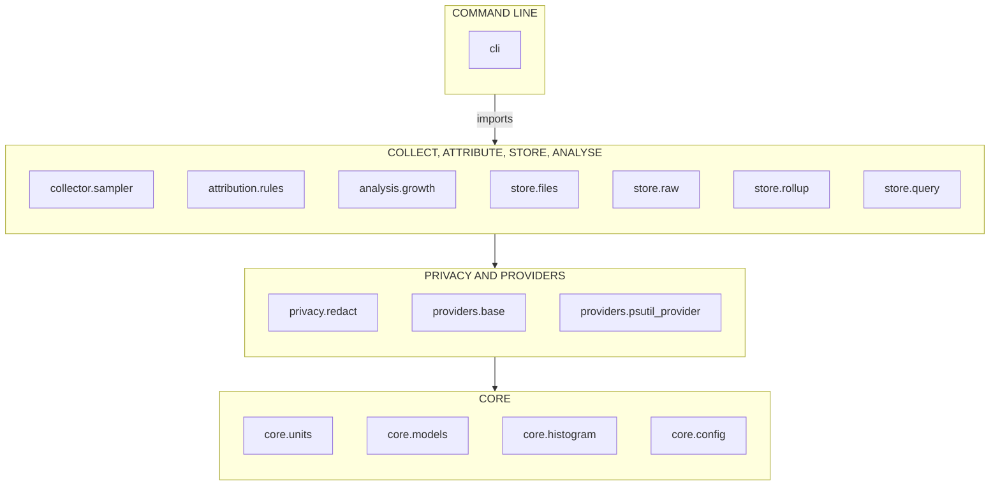

# Baseline modules

> Submeter build brief · Part 3, the build · [Index](README.md)

Fifteen Python modules that form the platform-neutral core of Submeter, with the project file and their tests. This is working code, written and run for this brief: 2,356 lines in the modules and 20 tests. They start twelve of the 21 components in the build list. Each entry says what the module does, why it exists, what it provides, what it imports and what imports it.

In this package the files are already in place at the paths shown, 26 files in all: the 19 described here and 7 empty `__init__.py` files, one in each package folder.

## What was checked, and what was not

- Ruff reports nothing. mypy in strict mode reports no issues in 25 files, checked as Linux and again as Windows. All 20 tests pass on Python 3.13. They also passed on 3.12, before the package required 3.13.
- Everything ran on Linux. `submeter top` took two snapshots of live processes and printed totals by workload.
- This package was unpacked into an empty folder, where `uv sync`, Ruff, mypy and the tests all passed.
- Nothing ran on Windows, so expect small fixes there. The one-instance lock was redesigned so that its lock file is never written, and its Windows calls are tested against a stand-in, but Windows itself has not answered them. Private-bytes memory in the psutil provider has never run. [`reference/windows-priorities.md`](reference/windows-priorities.md) lists what to check first, and `scripts/platform_check.py` checks it.
- The sample `submeter.toml` and `rules.toml` in `examples/` load through these modules without error.

## How they fit together

*Figure:* Imports point only downward. A module may import from its own package or from a lower layer, and `tests/test_layers.py` fails if one does otherwise. That rule is what lets the collector be replaced later without touching the rest.

The table gives the same links module by module. "Nothing yet" means the caller is built in a later phase, and until then only the tests call that module.

| Module | Lines | Imports | Imported by |
| --- | --- | --- | --- |
| [`core.units`](../src/submeter/core/units.py) | 140 | nothing in the package | cli, core.config |
| [`core.models`](../src/submeter/core/models.py) | 187 | nothing in the package | analysis.growth, attribution.rules, collector.sampler, core.config, providers.base, providers.psutil_provider, store.query, store.raw, store.rollup |
| [`core.histogram`](../src/submeter/core/histogram.py) | 92 | nothing in the package | store.rollup |
| [`core.config`](../src/submeter/core/config.py) | 318 | core.models, core.units | cli |
| [`privacy.redact`](../src/submeter/privacy/redact.py) | 83 | nothing in the package | store.raw |
| [`providers.base`](../src/submeter/providers/base.py) | 36 | core.models | cli |
| [`providers.psutil_provider`](../src/submeter/providers/psutil_provider.py) | 129 | core.models | cli |
| [`collector.sampler`](../src/submeter/collector/sampler.py) | 112 | core.models | cli |
| [`attribution.rules`](../src/submeter/attribution/rules.py) | 233 | core.models | cli |
| [`store.files`](../src/submeter/store/files.py) | 260 | nothing in the package | cli, store.raw |
| [`store.raw`](../src/submeter/store/raw.py) | 287 | core.models, privacy.redact, store.files | nothing yet |
| [`store.rollup`](../src/submeter/store/rollup.py) | 173 | core.histogram, core.models | nothing yet |
| [`store.query`](../src/submeter/store/query.py) | 54 | core.models | nothing yet |
| [`analysis.growth`](../src/submeter/analysis/growth.py) | 110 | core.models | nothing yet |
| [`cli`](../src/submeter/cli.py) | 142 | attribution.rules, collector.sampler, core.config, core.units, providers.base, providers.psutil_provider, store.files | entry point |

## How to check them

- Run `uv sync`, then `uv run ruff check`, `uv run mypy src tests` and `uv run pytest`. Expect 20 tests to pass.
- Then hand over the execution prompt. It tells the session that this baseline exists, and that the build extends it instead of rewriting it.

## Not in the baseline, and why

- The Windows bulk snapshot and the Job Object launcher. They call Windows APIs and must be written and tested on Windows.
- The Linux /proc reader and cgroup accounting. They come after version 1, behind the same provider protocol. Version 1 runs Linux polled through the psutil provider.
- The writer for the history file, the detectors that call the growth arithmetic, the server and the report. Each depends on decisions made in its own phase.

## Module by module

### `pyproject.toml`

49 lines · [open the file](../pyproject.toml)

Declares the package, its three runtime dependencies, the submeter command, and the Ruff, mypy and pytest settings from the brief.

- **Why it exists:** So that uv sync and uv run pytest work from the first commit, and every later module is checked the same way.
- **Worth knowing:**
  - Source lives under src/submeter, and tests import it through the pytest pythonpath setting.
  - mypy runs in strict mode with the Pydantic plugin. Ruff uses a 100-character line.
  - Requires Python 3.13 or newer, because from 3.13 `time.monotonic()` on Windows resolves 1 microsecond instead of 15.6 ms. The build backend is hatchling.
- **Builds toward:** Project file

### `src/submeter/__init__.py`

3 lines · [open the file](../src/submeter/__init__.py)

Names the package and holds the version string.

- **Why it exists:** The command line reads the version from here, so it is stated once.
- **Worth knowing:**
  - Three lines. Each package folder also needs an empty `__init__.py`, which this package includes.
- **Builds toward:** Package marker
- **Provides:** `__version__`

### `src/submeter/core/units.py`

140 lines · [open the file](../src/submeter/core/units.py)

Converts "250ms", "48h", "2GB", "50MB/h" and "1%" into seconds, bytes, bytes per second and fractions, and back again.

- **Why it exists:** Settings are written for people and code needs numbers. Doing the conversion in one place gives every malformed value the same error message.
- **Worth knowing:**
  - Sizes are binary: 1 GB is 1024 cubed bytes.
  - "forever" becomes infinity, which retention settings use.
  - `duration_range` and `fraction_range` build validators that refuse a value outside a range and name the range in the message.
  - Duration, Size, Fraction and Rate are the types that Pydantic fields use.
- **Builds toward:** Supports component 02, core.config
- **Provides:** `FOREVER`, `parse_duration`, `parse_size`, `parse_percent`, `parse_rate`, `format_duration`, `format_size`, `duration_range`, `fraction_range`, `Duration`, `Size`, `Fraction`, `Rate`
- **Imports:** pydantic
- **Imported by:** [`cli`](../src/submeter/cli.py), [`core.config`](../src/submeter/core/config.py)

### `src/submeter/core/models.py`

187 lines · [open the file](../src/submeter/core/models.py)

The frozen records passed between layers: counters, samples, workload totals, buckets, findings and capabilities.

- **Why it exists:** These classes are the contract between the collector, the server and the command line. Frozen and strict, so a record cannot be altered after it is made or carry a misspelt field.
- **Worth knowing:**
  - A process is identified by ProcessKey, which is pid plus start time.
  - Not here yet (finding R57, planned): ProcessCounters.cpu_s as float or None, where None means unreadable, and a Snapshot count of processes whose start time could not be read. Such a process gets no ProcessKey and appears only in that count.
  - Not here yet (finding R56, planned): the start time as the platform's integer stamp, ticks since boot with the boot id on Linux and CreateTime as a FILETIME integer on Windows. Today it is psutil's wall-clock float, so a clock step can cut a child from its parent's workload, and a provider that does not cache start times would re-key every process.
  - ProcessCounters holds running totals as a provider read them. ProcessSample holds what happened in one interval.
  - Both carry exe, the executable's file name where it can be read, and name, the process name, apart.
  - ProcessCounters has an optional children_cpu_s, for the Linux child time of children a process has reaped. No provider fills it yet.
  - Bucket carries everything needed to merge buckets exactly: sums, extremes, a time-weighted mean, two histograms and covered seconds.
  - GroupTotals holds what the kernel counted for one tagged group over one interval: CPU time, I/O (None when the group cannot report it) and process count.
  - Not here yet: separate fields for the two memory units. memory_bytes holds the unit read every tick, and the unit for workload totals, USS or PSS with the time it was read, is a planned field.
  - No behaviour lives here.
- **Builds toward:** Component 01, core.models
- **Provides:** `Record`, `Availability`, `AccountingSource`, `Severity`, `Confidence`, `Tier`, `Capability`, `ProcessKey`, `ProcessCounters`, `SystemCounters`, `Snapshot`, `ProcessSample`, `SampleBatch`, `WorkloadSample`, `Bucket`, `Finding`, `GroupTotals`
- **Imports:** pydantic
- **Imported by:** [`analysis.growth`](../src/submeter/analysis/growth.py), [`attribution.rules`](../src/submeter/attribution/rules.py), [`collector.sampler`](../src/submeter/collector/sampler.py), [`core.config`](../src/submeter/core/config.py), [`providers.base`](../src/submeter/providers/base.py), [`providers.psutil_provider`](../src/submeter/providers/psutil_provider.py), [`store.query`](../src/submeter/store/query.py), [`store.raw`](../src/submeter/store/raw.py), [`store.rollup`](../src/submeter/store/rollup.py)

### `src/submeter/core/histogram.py`

92 lines · [open the file](../src/submeter/core/histogram.py)

A 64-bin histogram that merges by adding bins and returns percentiles.

- **Why it exists:** A percentile of percentiles is not a percentile. Keeping a histogram in every bucket is what makes a weekly 95th percentile valid (finding R27).
- **Worth knowing:**
  - Two scales are defined: cores from 0.01 to 256, and memory from 16 MiB to 256 GiB.
  - A reported percentile is within one bin of the true value, a factor of about 1.17. The test checks that bound. The factor holds only inside the scale: a value below the low edge reads as somewhere between 0 and the low edge, and a value at or above the high edge reads as the high edge.
  - The 100th percentile is the upper edge of the highest bin that holds any time. With float weights the running sum can fall short of the total, so a percentile that the walk through the bins never reaches also returns that edge, not the top of the scale.
  - Weights are seconds, so the histogram is time-weighted.
  - merge can check only the bin count, and both scales have the same count. Keeping cores and memory histograms apart is the caller's job.
- **Builds toward:** Part of component 10, store.rollup
- **Provides:** `Scale`, `CORES`, `MEMORY`, `empty`, `add`, `merge`, `percentile`
- **Imports:** standard library only
- **Imported by:** [`store.rollup`](../src/submeter/store/rollup.py)

### `src/submeter/core/config.py`

318 lines · [open the file](../src/submeter/core/config.py)

Builds one immutable Settings object from defaults, submeter.toml, environment variables and overrides, and records where each value came from.

- **Why it exists:** The rule that values are refused and never clamped, and the config show --effective command, both need a single validated source of truth.
- **Worth knowing:**
  - Every default and range in the tables of `docs/08-configuration.md` was checked against this module. A value outside its range is refused, with the range in the error.
  - Unknown keys are errors, so a typo cannot silently do nothing.
  - Alert rules are structured fields. The TOML key "for" maps to the field duration.
  - Environment variables look like `SUBMETER_SAMPLING__ACTIVE_INTERVAL`.
  - The sample `submeter.toml` in `examples/` loads through this module without error.
  - Not here yet: the three built-in alert rules. The rules list holds only your own.
- **Builds toward:** Component 02, core.config
- **Provides:** `ENV_PREFIX`, `ActiveInterval`, `IdleInterval`, `IdleAfter`, `SlowInterval`, `GpuInterval`, `UssInterval`, `KeyframeInterval`, `OverheadShare`, `OverheadLimit`, `Sampling`, `Retention`, `Backups`, `ChangeThreshold`, `Storage`, `Leak`, `SlowGrowth`, `Baseline`, `Analysis`, `Verdict`, `AlertRule`, `Alerts`, `Attribution`, `Privacy`, `Providers`, `Api`, `Ui`, `Settings`, `ConfigError`, `LoadedSettings`, `load_settings`
- **Imports:** [`core.models`](../src/submeter/core/models.py), [`core.units`](../src/submeter/core/units.py), pydantic
- **Imported by:** [`cli`](../src/submeter/cli.py)

### `src/submeter/privacy/redact.py`

83 lines · [open the file](../src/submeter/privacy/redact.py)

Hides secrets in command lines and in free text before anything is stored.

- **Why it exists:** Command lines carry keys and tokens. Scrubbing on the way in means no later bug can expose what was never written (finding R04).
- **Worth knowing:**
  - Hides the value after a secret-looking flag, the value of a secret-looking NAME=value pair, known token shapes, URL passwords, and long opaque strings of letters and digits.
  - Errs towards hiding too much. A 40-character commit hash is hidden as well.
  - Ordinary arguments survive: --max-tokens 4096 is left alone.
  - In `exe_only` mode only the executable is kept.
- **Builds toward:** Component 16, privacy.redact
- **Provides:** `REDACTED`, `Mode`, `redact_text`, `redact_cmdline`
- **Imports:** standard library only
- **Imported by:** [`store.raw`](../src/submeter/store/raw.py)

### `src/submeter/providers/base.py`

36 lines · [open the file](../src/submeter/providers/base.py)

The protocol every process provider implements, and the capability report that doctor prints.

- **Why it exists:** The sampler depends on this protocol alone, so the psutil fallback, the Windows bulk snapshot, the Linux /proc reader and a fake in a test are interchangeable.
- **Worth knowing:**
  - Providers return running totals and never rates.
  - A capability is full, partial with what is missing, or unavailable with why.
- **Builds toward:** Component 03, providers.base
- **Provides:** `ProcessProvider`, `capability_report`
- **Imports:** [`core.models`](../src/submeter/core/models.py)
- **Imported by:** [`cli`](../src/submeter/cli.py)

### `src/submeter/providers/psutil_provider.py`

129 lines · [open the file](../src/submeter/providers/psutil_provider.py)

A process provider built on psutil, so it is not tied to one operating system.

- **Why it exists:** It gives a working collector on the first day. It is the fallback and cross-check the brief requires for the Windows bulk snapshot, and in version 1 it is the process reader on Linux.
- **Worth knowing:**
  - It asks about one process at a time, which is too slow for a 1-second cadence on a busy machine. On Windows it is not the hot path. On Linux in version 1 it is, so the overhead guard will hold the intervals longer there.
  - A refused read marks the process restricted, and the process is still returned. Any other failed read of I/O, the command line or the working folder leaves that field empty. A zombie is kept, because its CPU time is still readable. A process whose read fails in any other way is returned as a restricted record, so one process never costs the whole snapshot. Only a process that has already exited is left out.
  - On Linux, a process owned by another user keeps no command line: when its real user id differs from the collector's, the command line is not read and the process is marked restricted, so only its name is kept.
  - On Windows it skips pid 0, the System Idle Process, whose CPU time is the machine's idle time.
  - Not here yet: the System bucket. Nothing assigns SYSTEM. On Windows the provider returns the System, Registry, MemCompression and Secure System processes as ordinary processes, and on Linux it reads kernel threads as restricted processes, until a planned task marks them, on Linux by reading PF_KTHREAD from /proc/PID/stat.
  - exe is the file name of psutil's exe(), or name() when exe() cannot be read. name() is stored as name, because on Linux it is the program's own title.
  - Not here yet (finding R123, planned): reading a pid again through a fresh psutil object when psutil still lists it but reports it gone. Today, when a new process takes a pid that psutil's cache holds for an earlier process, the new one is missing from two snapshots and then credited no CPU for that time.
  - Not here yet (finding R57, planned): None for a CPU time it cannot read, and no stand-in start time. Today a refused CPU read is written as 0.0 CPU-seconds, and a process that fails to read at all is returned with the start time 0.0.
  - Memory is private bytes on Windows and resident memory elsewhere. On Windows it is read from psutil's `vms`, which is the pagefile usage, the same figure as private bytes. There is no fallback to working set. Swap is not added yet.
  - On Windows thread counts are not read, because psutil answers each with a query of the whole system, so they are None: unavailable, not zero. A process that cannot be read also gets None.
  - Disk I/O is left empty where psutil cannot read it, as on macOS.
  - Reading each working directory is off by default because of its cost.
- **Builds toward:** Fallback for component 04, and the Linux process reader in version 1 (component 05 comes after it)
- **Provides:** `PsutilProvider`
- **Imports:** [`core.models`](../src/submeter/core/models.py), psutil
- **Imported by:** [`cli`](../src/submeter/cli.py)

### `src/submeter/collector/sampler.py`

112 lines · [open the file](../src/submeter/collector/sampler.py)

Subtracts consecutive snapshots to find what each process did during the interval.

- **Why it exists:** Turning totals into deltas is where CPU time could be lost or invented. One module handles first sightings, reused process ids and gaps.
- **Worth knowing:**
  - The first call returns nothing, because there is no interval yet.
  - A process born during the interval is credited all its CPU time. An older process seen for the first time is credited none.
  - A reused pid is a new process, because identity includes the start time.
  - Each snapshot carries two clocks. Intervals are measured on the one that counts suspend: CLOCK_BOOTTIME on Linux, `time.monotonic()` on Windows. The other stops during suspend, CLOCK_MONOTONIC on Linux and QueryUnbiasedInterruptTime on Windows, and is read only for the suspend test. Where it is not read, there is no suspend test.
  - An interval longer than 30 seconds, or one in which the clock that counts suspend ran more than 2 seconds ahead of the clock that does not, is a gap: deltas are zero and the batch says so.
  - Not here yet: the adaptive cadence loop, the overhead guard, and on Linux the subtraction that stops a reaped child's CPU time and I/O being counted again in the process that reaped it. Until it is built, a Linux parent's I/O delta includes the I/O of the children it reaped.
  - The fixed 30-second rule and the zeroed deltas are wrong (finding R38), and a planned task replaces them together with R39's gap handling in the store. ingest() will take the interval expected for the tick. A tick will be a gap only past three times that interval plus the 2-second slack, or when the suspend test fires, and a gap will keep its CPU and I/O deltas. Until then any interval over 30 seconds records zero CPU, and `submeter top --seconds` above 30 prints zero cores for every workload.
  - Not here yet (finding R57, planned): no CPU baseline when either reading is None, and a cap on each credited CPU delta at the interval times the logical cores, with a count of the capped samples. Today a stand-in 0.0 becomes the next interval's baseline and credits a process's whole lifetime of CPU to one interval.
  - Not here yet (finding R55, planned): stamps anchored on the interval clock, and a 'clock stepped' event when the wall clock moves away from them. Today a batch is stamped with the wall clock as read, so a step back stamps a batch earlier than the one before, and nothing records the step.
- **Builds toward:** Core of component 07, collector.sampler
- **Provides:** `Sampler`
- **Imports:** [`core.models`](../src/submeter/core/models.py)
- **Imported by:** [`cli`](../src/submeter/cli.py)

### `src/submeter/attribution/rules.py`

233 lines · [open the file](../src/submeter/attribution/rules.py)

Gives every process exactly one workload, with the reason, and totals a batch by workload.

- **Why it exists:** The order of attribution and the rule that nothing is dropped are what let the parts be checked against the whole.
- **Worth knowing:**
  - Order: tagged kernel group, then Submeter itself, then rules in priority order, then inheritance from a valid parent, then Unattributed or Restricted.
  - Submeter itself is a set of pids, `self_pids`, not one pid, so that the collector, the server and the launcher's detached holders, and their children, all go to the `submeter` workload. `set_self_pids` replaces the set from the next batch, and a pid added after its process was first seen moves to `submeter`, with the move listed in `changes`.
  - A parent link counts only if the parent started no later than the child.
  - Attributor remembers each process's workload across batches and forgets it when assign() is told the process exited, so an inherited workload lasts for the life of the process. A remembered process moves only when a kernel group or a Submeter pid claims it, or when its executable or command line has changed and a rule matches it. Each move is listed in `changes`, for the caller to record as an event in the raw file.
  - Not here yet: seeding what Attributor remembers from the open raw file when the collector starts.
  - A rule may match on exe, name, cmdline, cwd and parent, the program that started the process. Every condition it gives must hold. exe and name match as glob patterns, and parent on the parent's executable file name, all ignoring case.
  - A rule's include_children decides whether the children of a process it matches inherit its workload. A rule that omits it follows inherit_from_parent.
  - `needs_cwd` tells the caller whether any rule uses the working folder, so that folders are read only then.
  - aggregate takes each tagged workload's group totals and reports the group's CPU time, process count and, when the group can report it, I/O, in place of the sum of its polled processes. It labels those workloads kernel, Restricted partial and the rest polled.
  - Not here yet: partial and unavailable figures. aggregate adds an I/O figure a process cannot give as 0 and still labels the workload polled. A tagged workload none of whose processes polling has seen shows 0 memory, and 0 I/O when its group cannot report I/O. A planned task marks such a figure partial, with the count of processes missing it, or unavailable when none can give it. aggregate also labels Restricted partial; the same task labels it polled, the path that measured its CPU time, and keeps the partial mark on each figure.
  - The sample `rules.toml` in `examples/` loads through this module without error.
- **Builds toward:** Component 15, attribution
- **Provides:** `UNATTRIBUTED`, `RESTRICTED`, `SYSTEM`, `SELF`, `Rule`, `RuleSet`, `Attribution`, `Attributor`, `aggregate`
- **Imports:** [`core.models`](../src/submeter/core/models.py), pydantic
- **Imported by:** [`cli`](../src/submeter/cli.py)

### `src/submeter/store/files.py`

260 lines · [open the file](../src/submeter/store/files.py)

The file map: where settings, data and state live on each platform, the name of the file for a given day or week, which files have expired, and the lock that stops two copies running.

- **Why it exists:** No other module builds a path by hand, so the layout can change in one place (finding R30).
- **Worth knowing:**
  - `SUBMETER_HOME` moves everything under one folder. The tests use it.
  - Raw files are named by UTC day, minute files by ISO week.
  - A file expires only once its whole day or week ended longer ago than the retention.
  - The lock file is only ever locked, never written. The holder's process id goes in a file beside it, NAME.pid.
  - A refused acquire() tries again every 100 ms for up to 5 seconds by default, because Windows may release a dead holder's lock some time after the holder dies. A caller that wants one try passes a wait of 0.
  - The lock was run on Linux with two real processes, and against a stand-in for the Windows locking call. How Windows itself answers has still to be run there.
- **Builds toward:** Component 08, store.files
- **Provides:** `HOME_VARIABLE`, `Program`, `utc_day`, `FileMap`, `InstanceLock`
- **Imports:** standard library only
- **Imported by:** [`cli`](../src/submeter/cli.py), [`store.raw`](../src/submeter/store/raw.py)

### `src/submeter/store/raw.py`

287 lines · [open the file](../src/submeter/store/raw.py)

Writes the daily raw file: workload totals every interval, process rows on change with keyframes, and command lines stored once.

- **Why it exists:** This is the redesigned raw store from the storage audit (findings R23, R25 and R31).
- **Worth knowing:**
  - CPU used between written rows is carried into the next row, so per-process sums stay exact. A test compares the stored sum with the true total.
  - A keyframe writes every live process in full. One opens each file and one follows every keyframe interval.
  - A gap is recorded in its own table, and that batch is written in full.
  - Not here yet (finding R39, planned): a gap column on workload_raw and system_raw, returned by workload_samples(). Until then a gap batch's workload and system rows look like observed time to the roll-up.
  - Command lines are redacted here whatever the caller did. A test reads the file bytes to confirm the secret is absent.
  - RawStore rolls over at UTC midnight and flushes pending CPU before closing a file.
  - Not here yet (finding R55, planned): RawStore never reopening a day earlier than the open file. Today a batch stamped on an earlier day, after a wall-clock step back across midnight, reopens that closed day's file.
- **Builds toward:** Component 09, store.raw
- **Provides:** `SCHEMA_VERSION`, `RawFile`, `RawStore`
- **Imports:** [`core.models`](../src/submeter/core/models.py), [`privacy.redact`](../src/submeter/privacy/redact.py), [`store.files`](../src/submeter/store/files.py)
- **Imported by:** Nothing yet. The collector loop will, in phase 2.

### `src/submeter/store/rollup.py`

173 lines · [open the file](../src/submeter/store/rollup.py)

Folds samples into buckets, and buckets into wider buckets, keeping totals exact.

- **Why it exists:** Rollups that cannot reproduce totals were the second critical finding of the storage audit (R24).
- **Worth knowing:**
  - Counters are summed. Gauges keep minimum, maximum, time-weighted mean and last value.
  - Each bucket records covered seconds and active seconds. A sample counts as active when the workload uses at least 0.005 of one core, the accumulator's `active_share`, which no setting changes.
  - Not here yet (finding R39, planned): a gap sample, which goes whole into the bucket that holds its end, adds its sums but no covered seconds, samples, active seconds, memory weight or histogram weight, and a bucket with no covered seconds closes and merges without dividing by zero. Until then a gap's whole interval counts as covered time with zero use: after a one-hour suspend one bucket claims more covered seconds than its width and the hour passes `well_covered`.
  - A sample goes whole to the bucket that holds its end time. The raw reader selects the same half-open window, so an hour read and rolled up gives the same bucket as the whole day rolled up. A test checks it with ticks at fractional seconds.
  - An hour merged from 60 minute buckets equals the hour built directly from samples. A test checks the sum, the mean, the extremes and the 95th percentile.
  - Merging buckets from different series is refused.
  - Pure functions with no files. The writer for the history file is still to build.
- **Builds toward:** Component 10, store.rollup
- **Provides:** `bucket_start`, `SeriesAccumulator`, `roll_up`, `merge`, `cores_percentile`, `memory_percentile`, `well_covered`
- **Imports:** [`core.histogram`](../src/submeter/core/histogram.py), [`core.models`](../src/submeter/core/models.py)
- **Imported by:** Nothing yet. The history writer will, in phase 3.

### `src/submeter/store/query.py`

54 lines · [open the file](../src/submeter/store/query.py)

Chooses the tier and step for a time window, and explains the choice.

- **Why it exists:** Without a rule, a 7-day chart could mix raw and rolled-up data without saying so (finding R33).
- **Worth knowing:**
  - Picks the finest tier whose retention still covers the start of the window.
  - Moves to a coarser tier, and then to wider steps, when the answer would hold more points than a chart can use.
  - Returns the reason as text, for the CLI and the report's charts to show.
- **Builds toward:** Component 11, store.query
- **Provides:** `TierChoice`, `choose_tier`
- **Imports:** [`core.models`](../src/submeter/core/models.py)
- **Imported by:** Nothing yet. The commands that read history, and the report, will.

### `src/submeter/analysis/growth.py`

110 lines · [open the file](../src/submeter/analysis/growth.py)

The Theil-Sen slope, the plateau test, the usual range from median and spread, and daily minimums.

- **Why it exists:** Leak and baseline checks need statistics that one spike cannot move.
- **Worth knowing:**
  - A leak is long enough, steep enough, and still climbing. Growth that stops is cleared.
  - `plateaued` compares the slope of the last third of the points with a quarter of the whole series' slope. With noise of up to 40 MB either way on each 1-minute point, the browser warm-up in [How it decides](07-analysis.md) is flagged in 18 to 34 of 60 runs, depending on the window, and a leak that grows in 2-hour steps is never flagged with a 2-hour window. Phase 4 replaces it, tuned together with the leak acceptance.
  - The slope is the median of the slopes between pairs of points, so one spike does not move it. A test confirms that with 20 points.
  - `check_growth` answers "not enough data yet" until it has 8 points spanning the minimum duration.
  - `usual_range` returns nothing until it has five values.
  - `daily_minimums` feeds the slow-growth check and takes a UTC offset for local days.
- **Builds toward:** Arithmetic for component 17, analysis.detectors
- **Provides:** `theil_sen`, `plateaued`, `GrowthResult`, `check_growth`, `usual_range`, `daily_minimums`
- **Imports:** [`core.models`](../src/submeter/core/models.py)
- **Imported by:** Nothing yet. The detectors will, in phase 4.

### `src/submeter/cli.py`

142 lines · [open the file](../src/submeter/cli.py)

The command line, with the first five commands: doctor, top, config show, config check and store status.

- **Why it exists:** It proves the modules connect end to end, and it stays thin so that no logic hides in it.
- **Worth knowing:**
  - submeter top takes two snapshots, attributes the difference and prints totals by workload.
  - doctor, top and store status accept --json. config show accepts --effective, which is also its default.
  - top reads working folders only when a rule matches on cwd.
  - A bad settings file exits with code 2 and one line per problem.
- **Builds toward:** Start of component 12, cli
- **Provides:** `app`, `config_app`, `store_app`, `JsonFlag`, `FileOption`, `doctor`, `top`, `config_show`, `config_check`, `store_status`
- **Imports:** [`attribution.rules`](../src/submeter/attribution/rules.py), [`collector.sampler`](../src/submeter/collector/sampler.py), [`core.config`](../src/submeter/core/config.py), [`core.units`](../src/submeter/core/units.py), [`providers.base`](../src/submeter/providers/base.py), [`providers.psutil_provider`](../src/submeter/providers/psutil_provider.py), [`store.files`](../src/submeter/store/files.py), typer
- **Imported by:** Nothing. It is the entry point behind the submeter command.

### `tests/test_baseline.py`

521 lines · [open the file](../tests/test_baseline.py)

Nineteen tests covering every module above, including one that runs the command line end to end.

- **Why it exists:** They state what each module promises, and they are how you confirm the files were copied correctly.
- **Worth knowing:**
  - Exact sums through change suppression, exact totals through rollups, and the histogram error bound are each tested directly.
  - The redaction test reads the database file bytes.
- **Builds toward:** Tests

### `tests/test_layers.py`

43 lines · [open the file](../tests/test_layers.py)

One rule, checked from the source itself: a module may import only from its own package or from a lower layer.

- **Why it exists:** This is what keeps the collector replaceable and the core reusable.
- **Worth knowing:**
  - Add a new package to the LAYER table when you create one.
- **Builds toward:** Tests
